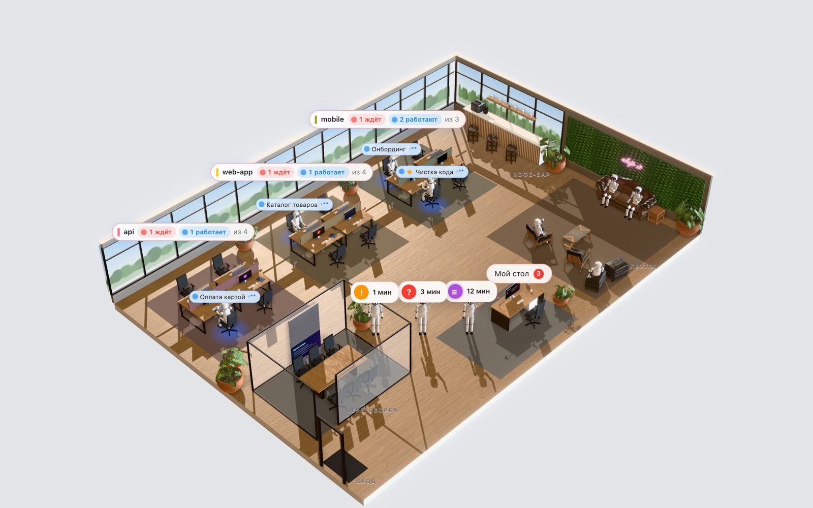
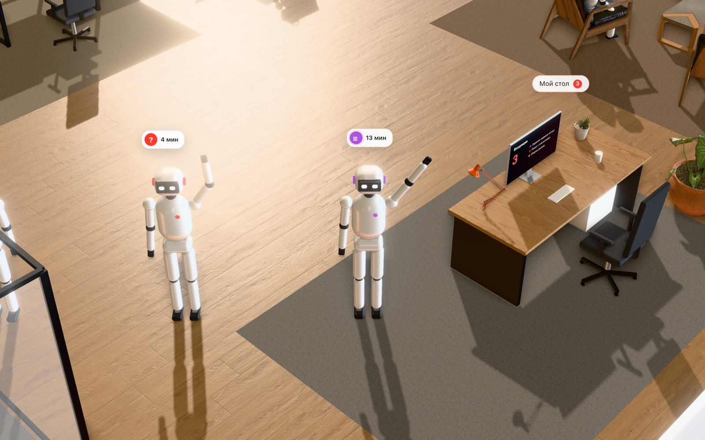

# AgentWatch — офис агентов Claude Code

Локальный 3D-офис за всеми сессиями Claude Code на твоём компьютере. Каждый проект — своя команда
за столами у окон. Когда агенту нужен ответ, он встаёт и идёт к **моему столу**: оттуда отвечаешь
на вопрос, даёшь разрешение, одобряешь план. Закончил задачу — тоже подходит, показать результат.
Свободные отдыхают в лаунже. Режим (План / Auto / Авто-правки) меняется прямо из офиса.



## Установка — плагин Claude Code

В любой сессии Claude Code (2.1.275+):

```
/plugin install agentwatch --marketplace Jamshidmirzo/agentwatch
```

<details><summary>Старые версии Claude Code — в две команды</summary>

```
/plugin marketplace add Jamshidmirzo/agentwatch
/plugin install agentwatch@agentwatch
```
</details>

Дальше ничего делать не нужно: при старте следующей сессии офис сам поднимется в фоне.
Открыть — **http://localhost:4777** или команда `/agentwatch` (покажет ссылку и состояние).
Первый запуск ставит зависимости и качает текстуры (~1–2 минуты, лог `~/.agentwatch/server.log`).

Удалить: `/plugin uninstall agentwatch`. Остановить офис до следующей сессии: `/agentwatch-stop`.

### Для всей команды — без ввода команд

Добавь в `.claude/settings.json` общего репозитория (закоммить):

```json
{
  "extraKnownMarketplaces": {
    "agentwatch": { "source": { "source": "github", "repo": "Jamshidmirzo/agentwatch" } }
  },
  "enabledPlugins": { "agentwatch@agentwatch": true }
}
```

Каждый, кто откроет этот проект в Claude Code и доверит папке, получит предложение установить
плагин — одним нажатием. Компаниям с управляемыми Mac то же самое можно раздать через managed settings.

## Что умеет



| | Свои сессии (VS Code / Terminal) | Нанятые из офиса (★) |
|---|---|---|
| Видно в офисе: работает за столом, свободен — в лаунже | ✓ | ✓ |
| Вопрос / разрешение / план — подходит к «моему столу», ответ оттуда | ✓ | ✓ |
| «Готово»: закончил задачу → подходит с результатом, «Посмотрел» — уходит | ✓ | ✓ |
| Режим: Обычный / Авто-правки / План / Auto | ✓ включается на ближайшем чтении/поиске агента | ✓ сразу (+ «Без вопросов») |
| Модель и effort | — Claude Code не даёт менять снаружи | ✓ на лету |
| Сообщение агенту | ✓ как будто напечатал ты: Terminal — во вкладку, VS Code — открыть сессию и нажать Enter (нужен «Универсальный доступ» в macOS) | ✓ |
| Перейти в окно сессии | ✓ VS Code, вкладка Terminal (macOS) | — |

Наём: «＋ Нанять» → проект, задача, модель, effort, режим — агент запускается через твой установленный
`claude` под твоим логином. Хоткеи: `I` — мой стол, `N` — нанять, `1–9` — вариант ответа,
`Enter` — главная кнопка, `J/K` — по очереди, `Esc`. Светлая/тёмная тема — как в системе.

## Агенты другого компьютера — прямо в этом офисе

Можно вести агентов второго компьютера отсюда: они появляются отдельными зонами «<Компьютер> · <проект>»,
идут к вашему столу; отвечаете, меняете режим, пишете, нанимаете — всё уходит туда.

1. Нужен свой **ретранслятор** (маленький сервер, ~$5/мес) — установка в [relay/README.md](relay/README.md).
   Его строку `wss://…/aw#ключ` вставьте здесь: «Компьютеры» → «Ретранслятор».
2. Здесь: «Компьютеры» → **«Добавить компьютер»** → одноразовое приглашение `aw1.…` (15 минут).
3. На том компьютере (плагин стоит, Node 22+): «Компьютеры» → вставить приглашение → **«Разрешить управлять»**.

Безопасность: связь только исходящая, у офиса не появляется входящих портов. Всё шифруется от компьютера
до компьютера (X25519 + общий секрет → AES-256-GCM, свежие ключи на каждое соединение) — ретранслятор
не может прочитать, подделать или повторить команду. Удалённо доступны только ответы со стола, режим,
сообщения, прервать/уволить, «Посмотрел», наём; открывать окна на том компьютере нельзя. На управляемом
компьютере — журнал действий `~/.agentwatch/remote.log`, выключатель «Разрешить управлять» и «Отозвать».

## Приватность

Всё локально: сервер слушает только `127.0.0.1`, видит только сессии этого пользователя
(`~/.claude`), никуда ничего не отправляет — кроме случая, когда вы сами подключили другой компьютер (см. выше). Мутации защищены токеном на запуск, хуки — отдельным
токеном в `~/.agentwatch/token`. Сеть нужна один раз — скачать npm-зависимости и текстуры.

## Требования

Claude Code, Node 18+. Лучше всего — macOS (переход в Terminal и VS Code сделан под Mac);
на Linux работает всё, кроме перехода во вкладку терминала. Windows не проверялся.

## Без плагина (вручную)

```
git clone https://github.com/Jamshidmirzo/agentwatch && cd agentwatch
npm install
./start.sh               # http://localhost:4777 (сам скачает текстуры), лог ~/.agentwatch.log
npm run hook:install     # хуки в ~/.claude/settings.json (бэкап рядом); убрать: npm run hook:uninstall
```

Не ставь одновременно и плагин, и `hook:install` — будут двойные хуки (офис склеит дубли, но лучше один способ).

## Как устроено

- `lib/registry.js` — сессии из `~/.claude/sessions/*.json` (busy / idle / waiting), хвост транскрипта, сабагенты.
- `lib/hosted.js` — нанятые агенты через `@anthropic-ai/claude-agent-sdk`; метаданные в `~/.agentwatch/hosted.json`, живут, пока жив сервер («Нанять → Вернуть на работу» — resume).
- `lib/inbox.js` — очередь «моего стола», общий формат решения для SDK и хука.
- `lib/hookbridge.js` — хук `PermissionRequest`: Claude Code показывает свой диалог **параллельно** с хуком, кто ответил первым — тот и решил. Ответил в самой сессии — запрос пропадает со стола; офис выключен — всё как обычно.
- Смена режима своей сессии: Claude Code меняет режим только ответом на запрос разрешения (`updatedPermissions: setMode`). Офис кладёт флаг `~/.agentwatch/mode/<session>`, `bin/pretool.sh` (PreToolUse, без сети) на ближайшем безопасном инструменте (Read / Grep / Glob…) просит разрешение, и офис сразу отвечает allow + setMode. Тот же скрипт отмечает текущий режим.
- `lib/reports.js` — «Готово»: переход «работал → свободен».
- `office/real.js`, `office/humanoid.js` — 3D-офис: PBR-текстуры, HDRI-свет, солнце через окна, мягкие тени, AO, роботы-гуманоиды. Без текстур — простой офис `office/scene.js` (или `?scene=classic`). Демо на тестовых данных: `/office/real.html`.
- Плагин: `.claude-plugin/` (манифест и маркетплейс), `hooks/hooks.json` (SessionStart → `bin/ensure.js`, PermissionRequest → `bin/permission-hook.js`, PreToolUse → `bin/pretool.sh`), `commands/`.

## Благодарности

Мебель, текстуры и HDRI — [Poly Haven](https://polyhaven.com) (CC0), скачиваются при первом запуске.
3D — [three.js](https://threejs.org) (MIT). Лицензия проекта — MIT.

---

**English.** AgentWatch is a local 3D office for all your Claude Code sessions: each project is a team
by the windows; agents walk to *your desk* when they need an answer (question / permission / plan) or
finish a task, and you reply right there. Switch a session's permission mode (Plan / Auto / Accept edits)
from the office. Install: `/plugin install agentwatch --marketplace Jamshidmirzo/agentwatch`, then open
http://localhost:4777 (or run `/agentwatch`). Everything runs on 127.0.0.1; UI is in Russian.
